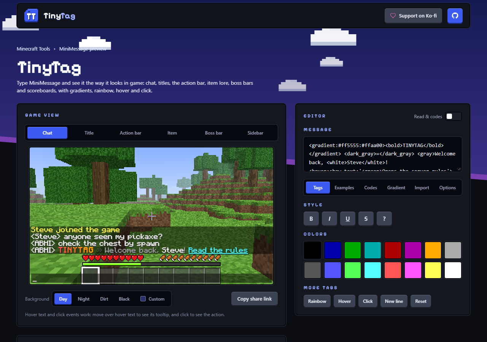

# TinyTag - "MiniMessage, as it looks in game"

> A simple, pretty browser tool that renders MiniMessage text in a Minecraft-style game UI: chat, titles, the action bar, item lore, boss bars and scoreboards, with gradient support.

[](LICENSE)
[](https://react.dev)
[](https://vite.dev)
[](https://nodejs.org)
[](#privacy)
[](https://ko-fi.com/abhixd)



## Why

Writing MiniMessage for a plugin config usually means restarting the server just to see a color. TinyTag shows the result right away, in the places players actually see it.

## Features

- **Six game views.** Chat, title and subtitle (with fade timings and a replay), action bar, item name and lore, boss bar, and sidebar scoreboard, shown over a generated first-person Minecraft-style world (day, night, the dirt menu background, plain black, or any color you pick) with the hotbar, hearts, food and XP bar.
- **Gradients.** `<gradient:...>` with any number of colors and a phase, `<rainbow>` (including `!` to reverse), and `<transition>`. A gradient builder with a live preview writes the tag for you.
- **Vanilla color codes.** A Codes tab lists all 16 colors and the formats with their `&a` / `§a` codes, hex values and MiniMessage names, drawn in the game font. Turn on **Read & codes** to type `&6&lGold`, `&#ff8800` or the `&x&f&f&8&8&0&0` form and see it exactly as the game shows it (a color code clears earlier formats, a format code keeps the color).
- **Colors and styles.** Named colors, hex colors, `<color:...>`, bold, italic, underlined, strikethrough, obfuscated (animated), and `<!negations>`.
- **Hover and click.** `<hover:show_text:...>` shows a real tooltip when you move over the text, and `<click:...>` shows what the click would do.
- **Game-accurate details.** A Minecraft-style pixel font with the game's own character widths and line wrapping, quarter-brightness text shadows, one-pixel underline and strikethrough lines, item names and lore that are italic by default, and a dark purple lore color.
- **Tag buttons.** Wrap selected text in a color, style or tag with one click.
- **Export.** Copy the result as plain text or as a Minecraft JSON text component.
- **Warnings.** Unknown tags, bad colors and unmatched closing tags are listed instead of failing silently.
- **Remembers your text** between visits.

## Supported tags

| Tag | Example |
| --- | --- |
| Color | `<red>`, `<#ff8800>`, `<color:gold>`, `</red>` |
| Style | `<bold>` (`<b>`), `<italic>` (`<i>`, `<em>`), `<underlined>` (`<u>`), `<strikethrough>` (`<st>`), `<obfuscated>` (`<obf>`), `<!italic>` |
| Gradient | `<gradient:#ff0000:#0000ff>`, `<gradient:red:gold:yellow:0.5>` |
| Rainbow | `<rainbow>`, `<rainbow:!>`, `<rainbow:0.3>` |
| Transition | `<transition:#ff0000:#00ff00:#0000ff:0.5>` |
| Hover | `<hover:show_text:'<green>Hello'>` |
| Click | `<click:open_url:https://example.com>`, `run_command`, `suggest_command`, `copy_to_clipboard` |
| Other | `<newline>` (`<br>`), `<reset>`, `<insertion:text>`, `<pre>...</pre>`, `\<escaped>` |

Tags whose values only exist in game (`<lang>`, `<key>`, `<score>`, `<nbt>` and similar) are shown as a placeholder, and `<font>` and `<shadow>` are accepted but not shown.

## Getting started

You need [Node.js](https://nodejs.org) 22 or newer.

```bash
git clone https://github.com/abhixdd/tinytag.git
cd tinytag
npm install
npm run dev
```

Open the address Vite prints (usually http://localhost:5173).

## Scripts

| Command | What it does |
| --- | --- |
| `npm run dev` | Start the development server |
| `npm run build` | Production build into `dist/` |
| `npm run preview` | Serve the production build locally |
| `npm run lint` | Run oxlint |
| `npm test` | Run the parser tests |

## Privacy

Everything runs in your browser. Nothing you type is sent anywhere. Your text is saved in your browser's own storage so it is still there next time.

## Limitations

- It is a preview, not the game. Fonts and spacing are close but not pixel-exact, so do a final check in Minecraft.
- The text uses Monocraft, a Minecraft-style font, not Mojang's own font. Spacing and wrapping follow the game's character widths, but letter shapes differ slightly.
- The world behind the text is generated in code from small noise textures. It is a backdrop, not a real Minecraft screenshot.
- It supports the common parts of MiniMessage, not every tag in every Adventure version.

## Contributing

Bug reports, ideas and pull requests are welcome. Please read [CONTRIBUTING.md](CONTRIBUTING.md) first, and run `npm run lint`, `npm test` and `npm run build` before opening a pull request. Security problems go through [SECURITY.md](SECURITY.md), and everyone is expected to follow the [Code of Conduct](CODE_OF_CONDUCT.md).

## Support

TinyTag is free. If it saves you time, you can [buy me a coffee on Ko-fi](https://ko-fi.com/abhixd).

## License

TinyTag is free and open source software under the [GNU Affero General Public License v3.0](LICENSE) (AGPL-3.0). If you distribute a modified version, or run one as a network service such as a website, you must make its complete source code available to its users under the same license.

Copyright (c) 2026 ABHI.

## Credits and notices

- TinyTag is an unofficial fan tool. It is not affiliated with Mojang, Microsoft or the Adventure project. Minecraft is a trademark of Mojang AB. MiniMessage is a text format created by the Adventure project.
- [Monocraft](https://github.com/IdreesInc/Monocraft) (the game text) and Pixelify Sans (the page headings) are used under the SIL Open Font License 1.1 (`public/fonts/OFL-Monocraft.txt` and `public/fonts/OFL.txt`).
- Built with [React](https://react.dev), [Vite](https://vite.dev) and [Tailwind CSS](https://tailwindcss.com), each under its own license.

Made by [ABHI](https://github.com/abhixdd).
